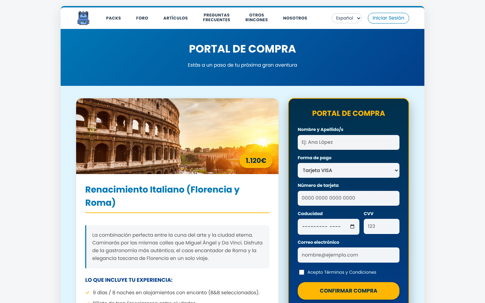

# Mochileros por el Mundo

🇬🇧 English · [🇪🇸 Español](README.es.md)

   **Live demo:** https://diazcolladopaula.github.io/mochileros-travel-website/
   
A static website for a fictional travel agency with a built-in community blog. It is built with plain HTML5, CSS3 and vanilla JavaScript (no frameworks, no backend) and was developed as a group project (four students) for a User Interfaces course at university.


## Features

- **Trip catalogue with live filtering** by country, star rating and trip type. Filters live in a fixed side panel on desktop and in a collapsible menu on mobile.
- **Guided checkout**: pick a pack, then fill in a payment form that validates email, card number, expiry date and CVV before simulating the purchase.
- **Community forum** with accordion threads, replies, new topics, and deletion of your own messages.
- **Blog** with an article list and a detail view loaded dynamically.
- **"Otros rincones" gallery** (hidden gems) with a like counter per destination, with photos from [Unsplash](https://unsplash.com), some stored locally and the rest loaded from its CDN.
- **Sign up and log in** with email format checks, password rules (length, uppercase, number, special character), duplicate username detection, and an optional "remember me" session.
- **Bilingual UI (ES/EN)** driven by a central translation dictionary in `main.js` and `data-lang` attributes.
- **Client-side persistence**: users, session, forum threads, likes and purchases are stored in `localStorage` / `sessionStorage`.
- **Responsive layout** from desktop down to small phones.

| Packs and filters | Checkout |
| --- | --- |
|  |  |

## Project structure

```
src/
├── *.html      10 pages: home, packs, checkout, forum, articles,
│               hidden gems, FAQ, about, login, sign up
├── scripts/    One JS file per page, plus main.js with shared code
│               (language, session, carousel, active menu item)
├── styles/     One stylesheet per page, plus global styles
└── images/
docs/
└── screenshots/
```

## Running it locally

No build step is needed. Serve the `src/` folder with any static HTTP server:

```bash
cd src
python3 -m http.server 8000
# open http://localhost:8000/
```

## Technical notes

- Page content (packs, articles, FAQ, forum threads, destinations) lives in JavaScript data objects with `es` / `en` fields, and the pages render from them. Switching language re-renders the dynamic content without a reload.
- All forms validate on the client and show specific, localized error messages per field.

## Limitations

This is a front-end prototype. Authentication runs entirely in the browser: usernames and passwords are stored unencrypted in `localStorage`, and payments are simulated. It is not meant for production use, which would need a real backend and proper credential handling.

## Credits

Destination photos in the "Otros rincones" gallery come from [Unsplash](https://unsplash.com) and are used under the [Unsplash License](https://unsplash.com/license).
